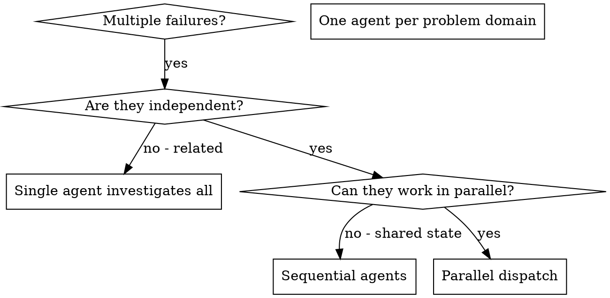

# การส่ง Agent ทำงานคู่ขนาน

## ภาพรวม

คุณมอบหมายงานให้ agent เฉพาะทางที่มี context แยกกัน โดยเขียนคำสั่งและบริบทให้ตรงจุด เพื่อให้พวกมันโฟกัสและทำงานสำเร็จ พวกมันต้องไม่รับ context หรือประวัติของ session คุณ - คุณสร้างเฉพาะสิ่งที่มันต้องใช้ วิธีนี้ยังช่วยรักษา context ของคุณไว้ใช้ประสานงาน

เมื่อมีความล้มเหลวหลายอย่างที่ไม่เกี่ยวกัน (ไฟล์เทสต์ต่างกัน, ระบบย่อยต่างกัน, บั๊กต่างกัน) การไล่ตรวจทีละอันเสียเวลา แต่ละการสืบสวนเป็นอิสระและทำพร้อมกันได้

**หลักการ:** ส่ง agent หนึ่งตัวต่อหนึ่งโดเมนปัญหาที่เป็นอิสระ ให้ทำงานพร้อมกัน

## เมื่อไหร่ควรใช้



**ใช้เมื่อ:**
- ไฟล์เทสต์ตั้งแต่ 3 ไฟล์ล้มเหลวด้วยสาเหตุต่างกัน
- ระบบย่อยหลายตัวพังแยกกัน
- เข้าใจแต่ละปัญหาได้โดยไม่ต้องรู้บริบทของปัญหาอื่น
- ไม่มีสถานะร่วมกันระหว่างการสืบสวน

**ห้ามใช้เมื่อ:**
- ความล้มเหลวเกี่ยวข้องกัน (แก้อันหนึ่งอาจแก้อันอื่นด้วย)
- ต้องเข้าใจสถานะของระบบทั้งหมด
- agent จะรบกวนกันเอง

## รูปแบบการทำงาน

### 1. ระบุโดเมนที่เป็นอิสระ

จัดกลุ่มความล้มเหลวตามสิ่งที่พัง:
- เทสต์ไฟล์ A: ขั้นตอนการอนุมัติ tool
- เทสต์ไฟล์ B: พฤติกรรมเมื่อ batch เสร็จ
- เทสต์ไฟล์ C: ฟังก์ชัน abort

แต่ละโดเมนเป็นอิสระ - การแก้การอนุมัติ tool ไม่กระทบเทสต์ abort

### 2. สร้างงานที่โฟกัสให้แต่ละ agent

แต่ละ agent ได้รับ:
- **ขอบเขตเฉพาะ:** เทสต์หนึ่งไฟล์หรือระบบย่อยหนึ่งตัว
- **เป้าหมายชัดเจน:** ทำให้เทสต์เหล่านี้ผ่าน
- **ข้อจำกัด:** ห้ามแก้โค้ดส่วนอื่น
- **ผลลัพธ์ที่คาดหวัง:** สรุปสิ่งที่พบและสิ่งที่แก้

### 3. ส่งงานพร้อมกัน

สั่งส่ง subagent ทั้งสามตัวในการตอบครั้งเดียว - มันจะทำงานคู่ขนานกัน:

```text
Subagent (general-purpose): "Fix agent-tool-abort.test.ts failures"
Subagent (general-purpose): "Fix batch-completion-behavior.test.ts failures"
Subagent (general-purpose): "Fix tool-approval-race-conditions.test.ts failures"
# ทั้งสามทำงานพร้อมกัน
```

เรียกส่งหลายตัวในการตอบครั้งเดียว = ทำงานคู่ขนาน ส่งทีละตัวต่อการตอบ = ทำงานตามลำดับ

### 4. ตรวจและรวมผล

เมื่อ agent ส่งผลกลับ:
- อ่านสรุปของแต่ละตัว
- ตรวจว่าการแก้ไม่ขัดกัน
- รันชุดเทสต์ทั้งหมด
- รวมการเปลี่ยนแปลงทั้งหมด

## โครงสร้าง prompt ของ agent

prompt ที่ดีต้อง:
1. **โฟกัส** - โดเมนปัญหาเดียวที่ชัดเจน
2. **ครบในตัว** - มีบริบททั้งหมดที่จำเป็นต่อการเข้าใจปัญหา
3. **ระบุผลลัพธ์ชัดเจน** - agent ควรส่งอะไรกลับมา?

```markdown
Fix the 3 failing tests in src/agents/agent-tool-abort.test.ts:

1. "should abort tool with partial output capture" - expects 'interrupted at' in message
2. "should handle mixed completed and aborted tools" - fast tool aborted instead of completed
3. "should properly track pendingToolCount" - expects 3 results but gets 0

These are timing/race condition issues. Your task:

1. Read the test file and understand what each test verifies
2. Identify root cause - timing issues or actual bugs?
3. Fix by:
   - Replacing arbitrary timeouts with event-based waiting
   - Fixing bugs in abort implementation if found
   - Adjusting test expectations if testing changed behavior

Do NOT just increase timeouts - find the real issue.

Return: Summary of what you found and what you fixed.
```

## ความผิดพลาดที่พบบ่อย

**❌ กว้างเกินไป:** "แก้เทสต์ทั้งหมด" - agent หลงทาง
**✅ เจาะจง:** "แก้ agent-tool-abort.test.ts" - ขอบเขตโฟกัส

**❌ ไม่มีบริบท:** "แก้ race condition" - agent ไม่รู้ว่าอยู่ตรงไหน
**✅ มีบริบท:** แปะข้อความ error และชื่อเทสต์

**❌ ไม่มีข้อจำกัด:** agent อาจ refactor ทุกอย่าง
**✅ มีข้อจำกัด:** "ห้ามแก้โค้ด production" หรือ "แก้เฉพาะเทสต์"

**❌ ผลลัพธ์คลุมเครือ:** "แก้มันซะ" - ไม่รู้ว่าเปลี่ยนอะไร
**✅ เจาะจง:** "ส่งสรุปสาเหตุและการเปลี่ยนแปลงกลับมา"

## เมื่อไหร่ "ไม่" ควรใช้

**ความล้มเหลวที่เกี่ยวข้องกัน:** แก้อันหนึ่งอาจแก้อันอื่น - สืบสวนรวมกันก่อน
**ต้องมีบริบททั้งหมด:** การเข้าใจต้องเห็นทั้งระบบ
**การดีบักเชิงสำรวจ:** ยังไม่รู้ว่าอะไรพัง
**สถานะร่วมกัน:** agent จะรบกวนกัน (แก้ไฟล์เดียวกัน, ใช้ทรัพยากรเดียวกัน)

## ตัวอย่างจริงจาก session

**สถานการณ์:** เทสต์ล้มเหลว 6 รายการใน 3 ไฟล์หลัง refactor ครั้งใหญ่

**ความล้มเหลว:**
- agent-tool-abort.test.ts: 3 รายการ (ปัญหาเรื่องเวลา)
- batch-completion-behavior.test.ts: 2 รายการ (tool ไม่ทำงาน)
- tool-approval-race-conditions.test.ts: 1 รายการ (จำนวนการทำงาน = 0)

**การตัดสินใจ:** โดเมนเป็นอิสระ - ตรรกะ abort แยกจาก batch completion แยกจาก race conditions

**การส่งงาน:**
```
Agent 1 → Fix agent-tool-abort.test.ts
Agent 2 → Fix batch-completion-behavior.test.ts
Agent 3 → Fix tool-approval-race-conditions.test.ts
```

**ผลลัพธ์:**
- Agent 1: เปลี่ยน timeout เป็นการรอตามเหตุการณ์
- Agent 2: แก้บั๊กโครงสร้าง event (threadId อยู่ผิดที่)
- Agent 3: เพิ่มการรอให้การทำงานของ tool แบบ async เสร็จ

**การรวมผล:** ทุกการแก้เป็นอิสระ ไม่ขัดกัน ชุดเทสต์ทั้งหมดเขียว

## การตรวจสอบ

หลัง agent ส่งผลกลับ:
1. **อ่านสรุปแต่ละตัว** - เข้าใจว่าเปลี่ยนอะไร
2. **ตรวจความขัดแย้ง** - agent แก้โค้ดเดียวกันหรือไม่?
3. **รันชุดเทสต์ทั้งหมด** - ยืนยันว่าทุกการแก้ทำงานร่วมกันได้
4. **สุ่มตรวจ** - agent อาจทำผิดแบบเป็นระบบ
