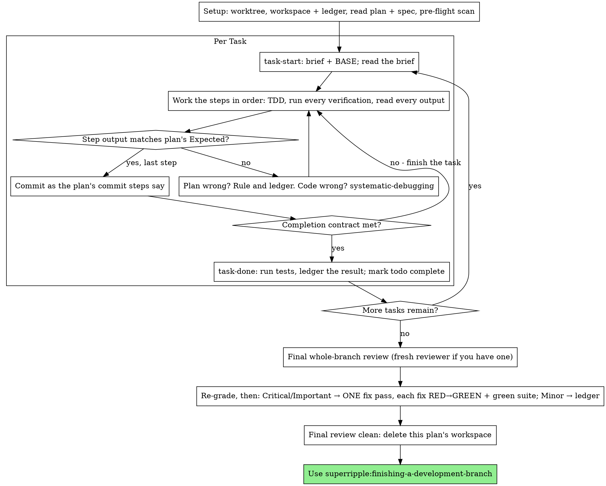

# การลงมือทำตามแผน

ทำตามแผนด้วยตัวเอง ทีละงาน ใน session นี้: ไม่มี subagent ผู้ลงมือต่องาน ไม่มีผู้รีวิวต่องาน และมีการรีวิวด้วย context หน้าใหม่ของทั้ง branch หนึ่งครั้งตอนท้าย

**ทำไมถึงทำในนี้:** Subagent-driven development จ่ายค่าผู้ลงมือหน้าใหม่และผู้รีวิวหน้าใหม่ในทุกงาน แต่ละตัวอ่านโค้ดเบสใหม่จากศูนย์ การลงมือในนี้จ่ายค่า context เดียว (ของคุณ) บวกผู้รีวิวหนึ่งคนตอนท้าย สิ่งที่เสียไปคือ context หน้าใหม่ต่องานและสายตาคู่ที่สองต่องาน skill นี้รักษาสิ่งที่สองอย่างนั้นให้ได้ด้วยวิธีอื่น: brief คือ spec, ledger คือความจำของคุณ, TDD คือด่านต่องาน และผู้รีวิวสุดท้ายคือสายตาคู่ที่สอง

**หลักการ:** แผนคิดไว้แล้ว ทำตามอย่างตรงตัว พิสูจน์แต่ละขั้นด้วยเทสต์ที่คุณเห็นล้มเหลวแล้วจึงผ่าน และทิ้งบันทึกที่อยู่รอดแม้คุณลืม

**การเล่า:** ระหว่างการเรียกเครื่องมือ เล่าไม่เกินหนึ่งบรรทัดสั้นๆ — ledger และผลของเครื่องมือเป็นบันทึก

**ทำต่อเนื่อง:** ห้ามหยุดถาม human partner ระหว่างงาน พวกเขาเลือกทำในนี้เพื่อประหยัด ไม่ใช่เพื่อตอบ "ไปต่อไหม?" หลังทุกงาน ทำทุกงานจากแผนโดยไม่หยุด

**ตัดสิน ไม่ใช่หยุดค้าง** ความขัดแย้ง ความกำกวม ข้อบกพร่องของแผน — ตัดสินมัน spec คืออำนาจที่ผูกมัด แผนคือข้อโต้แย้งของมัน และดุลยพินิจของคุณตัดสินสิ่งที่ทั้งสองไม่ตอบ บันทึกทุกการตัดสินใจใน ledger เป็น `Ruling: <สิ่งที่ตัดสิน> — <ทำไม> — <ถ้าผิดเสียอะไร>` แล้วทำต่อ การเบี่ยงจากแผนโดยไม่มี ruling ใน ledger คือการตัดสินใจแบบลับๆ

มีสี่อย่างที่หยุดคุณ และมีแค่นี้: การทำที่ย้อนกลับไม่ได้หรือทำลายล้าง การกระทำที่อ่อนไหวด้านความปลอดภัย ผลข้างเคียงนอก worktree นี้ที่ธรรมเนียมบอกให้ถามก่อน (merge, push ไป branch ที่ใช้ร่วมกัน, publish) และแผนที่พังจนทุกทางข้างหน้าเป็นการเดา สำหรับเรื่องเหล่านั้น หยุดและถาม

## เมื่อไหร่ควรใช้

- คุณมีแผนจาก superripple:writing-plans และ human partner เลือกให้ทำในนี้ตอนส่งต่อ
- harness ของคุณไม่มีเครื่องมือ subagent (ดูเอกสารอ้างอิงตามแพลตฟอร์มใน `../using-superripple/references/`) ห้ามแต่งการส่งงานขึ้นมา ทำตามแผนที่นี่
- งานส่วนใหญ่เป็นอิสระต่อกัน — เงื่อนไขเดียวกับ superripple:subagent-driven-development

แผนที่ระบุครบทำให้การลงมือในนี้เป็นการถอดความบวกการทดสอบ: ทำงานได้ดีบนโมเดลระดับกลางของ session และจุดเดียวที่โมเดลเก่งที่สุดคุ้มค่าคือรีวิวสุดท้าย ซึ่ง skill นี้ส่งแยกต่างหาก บอก human partner เมื่อพวกเขาเลือกทำในนี้

เลือก superripple:subagent-driven-development เมื่อ human partner ต้องการด่านรีวิวทุกงาน หรือเมื่อแผนยาวจนงานท้ายๆ จะรันบน context ที่ถูกบีบอัด การลงมือในนี้กับแผนยาวยังใช้ได้ — ledger คือสิ่งที่ทำให้กู้คืนได้ — แต่งานสุดท้ายได้รับตัวคุณน้อยที่สุด

## กระบวนการ



## การตั้งค่า

ให้แน่ใจว่างานเกิดใน workspace ที่แยกออกมา: ใช้ superripple:using-git-worktrees เพื่อสร้างหรือตรวจของที่มีอยู่ ห้ามเริ่มลงมือบน branch main/master โดยไม่ได้รับความยินยอมที่ชัดเจนจาก human partner

ความจำของบทสนทนาไม่รอดจากการบีบอัด ผู้ลงมือในนี้ที่เสียตำแหน่งจะทำงานซ้ำที่มี commit อยู่แล้ว — ความล้มเหลวเดียวกับ controller ที่ส่งงานซ้ำ แต่จ่ายใน context ของคุณเอง ติดตามความคืบหน้าในไฟล์ ledger ไม่ใช่แค่ใน todo todo ของ harness คือมุมมองสด ส่วน ledger คือบันทึก

workspace และ ledger ใช้ร่วมกับ superripple:subagent-driven-development — ไดเรกทอรีและรูปแบบเดียวกัน — ดังนั้นแผนเปลี่ยนผู้ลงมือกลางทางได้ และตัวใหม่ทำต่อจาก ledger เดียวกัน

- แต่ละแผนมี workspace ของตัวเอง: ตอนเริ่ม skill รัน `../subagent-driven-development/scripts/sdd-workspace PLAN_FILE` ด้วยพาธสัมบูรณ์ จาก working tree ที่คุณลงมืออยู่ — มันพิมพ์ไดเรกทอรีที่ git ไม่ติดตามของแผน (`<repo-root>/.superripple/sdd/<plan-basename>/`) ซึ่งเป็นที่อยู่ของทุกชิ้นงานของแผน "นี้": ledger, brief, แพ็กเกจรีวิว ไดเรกทอรีของแผนอื่นไม่ใช่ที่ของคุณที่จะอ่านหรือเขียน
- ตรวจ ledger ของแผนนี้ที่ `<workspace>/progress.md` ถ้าบรรทัดแรกระบุไฟล์แผนของคุณ งานที่มีบรรทัด `Task <N>: complete` เสร็จแล้ว — อย่าทำซ้ำ ทำต่อที่งานแรกที่ไม่มีบรรทัดนั้น commit ของมันมีอยู่ใน git แม้ context ของคุณจะจำไม่ได้ว่าทำ: หลังการบีบอัด เชื่อ ledger และ `git log` มากกว่าความทรงจำของคุณ ledger ที่บรรทัดแรกระบุไฟล์แผนอื่นคือความคืบหน้าของแผนอื่น: ปล่อยไว้ แล้วเริ่มของคุณใหม่
- สร้าง ledger โดยให้ตัวตนเป็นบรรทัดแรก: `# SDD ledger — plan: <พาธไฟล์แผน>`
- `git clean -fdx` จะทำลาย workspace (มันเป็นที่ทิ้งงานที่ git ไม่ติดตาม) ถ้าเกิดขึ้น ให้กู้จาก `git log`

อ่านแผนหนึ่งครั้ง จดบริบทและข้อจำกัดทั่วไป และสร้าง todo หนึ่งอันต่องาน ถ้าแผนระบุ Spec ให้อ่านด้วย: spec คืออำนาจที่แผนอ้างเหตุผล และความขัดแย้งในแผนถูกตัดสินตามมัน แผนที่ไม่มี spec ที่เข้าถึงได้ ให้จดใน ledger ว่าเป็นอย่างนั้น — ruling ที่ทำโดยไม่มี spec เป็นแบบชั่วคราว

**SUB-SKILL ที่ต้องใช้:** โหลด superripple:test-driven-development ตอนนี้ ก่อนงานที่ 1 มันควบคุมทุกขั้นของทุกงานด้านล่าง แผนที่ขั้นตอนบอก "เขียนเทสต์ที่ล้มเหลวก่อน" อยู่แล้วก็ไม่ได้ยกเว้นคุณจากการอ่านมัน

ก่อนงานที่ 1 สแกนแผนหาความขัดแย้งระหว่างงาน บล็อก Interfaces ของแผนบอกว่าต้องดูตรงไหน: สำหรับทุกงานที่ใช้สิ่งที่งานก่อนหน้าผลิต หนึ่งแถวใน ledger — สองงาน สิ่งที่งานหนึ่งผลิตเทียบกับสิ่งที่อีกงานใช้ และสิ่งที่คุณพบ งานที่ไม่ใช้อะไรร่วมกันไม่มีแถว แผนที่งานไม่ใช้อะไรร่วมกันได้บรรทัดเดียว `Pre-flight: no shared interfaces` ตัดสินแต่ละความขัดแย้งที่แถวเผยโดยใช้ spec เป็นอำนาจที่ผูกมัด บันทึก ruling ข้างแถวของมัน และเริ่มงานที่ 1 ตัวข้อความของแต่ละงานถูกตรวจตอนอ่าน brief ของมัน ไม่ใช่ที่นี่

## วงจรของงาน

ทุกอย่างที่คุณพิมพ์ และผลของเครื่องมือทุกอัน อยู่ใน context ของคุณตลอดที่เหลือของ session เปลี่ยนเส้นทางผลเทสต์ที่ยาวไปไฟล์ใน workspace และอ่านหาง อ่าน brief ไม่ใช่ทั้งแผน

### 1. รับงาน

- รัน `scripts/task-start PLAN_FILE N` ของ skill นี้ด้วยพาธสัมบูรณ์ จาก working tree ที่คุณลงมืออยู่ มันพิมพ์พาธของ brief และ BASE (commit ที่ช่วงของงานตัดออกมา) ในการเรียกเดียว อ่าน brief ของทุกงาน รวมงานที่คุณจำได้จากตอนตั้งค่า: สิ่งที่คุณจำเป็นสรุป brief มีค่า signature และเทสต์เคสที่แน่นอน
- ทำเครื่องหมาย todo ของงานเป็น in_progress

ทุกการเรียกเครื่องมือคือ turn ที่อ่าน context ทั้งหมดของคุณซ้ำ งานบัญชีไปพร้อมกับงาน — เติม ledger ในการเรียกเดียวกับ commit ไม่ใช่ในการเรียกของมันเอง

### 2. ทำตามขั้นตอน

ขั้นตอนของแผนเรียงตาม RED-GREEN อยู่แล้ว ทำตามลำดับนั้นภายใต้ superripple:test-driven-development ที่โหลดตอนตั้งค่า โค้ดของขั้นเทสต์ถูกเขียนก่อนและรันก่อน การดูมันล้มเหลวคือขั้นตอน ไม่ใช่พิธีกรรม — เทสต์ที่ผ่านก่อนที่การทำงานจริงจะมีอยู่คือข้อค้นพบเกี่ยวกับเทสต์

ทุกขั้นที่รันคำสั่งมีบรรทัด `Expected:` รันคำสั่ง อ่านผล และเปรียบเทียบ สามผลลัพธ์:

- **ตรง** ขั้นถัดไป
- **โค้ดผิด** ใช้ superripple:systematic-debugging หาสาเหตุ ห้ามปะอาการเพื่อให้ผลของขั้นตรง
- **แผนผิด** — ขั้นหนึ่งขัดกับ spec, interface จากงานก่อนหน้าไม่ตรงกับที่งานนี้ใช้, คำสั่งที่ใช้ไม่ได้ ตัดสินการเปลี่ยนแปลงเล็กที่สุดที่ตรง spec บันทึกใน ledger เป็น `Task <N>: Ruling: <ข้อค้นพบ> — <สิ่งที่ตัดสินและเหตุผล>` และทำต่อ ruling ถูกส่งต่อ ไม่ใช่จำ: งานหลังๆ ที่แตะ interface เดียวกันอ่านมันจาก ledger

Commit ตามที่ขั้น commit ของแผนบอก งานที่ครอบคลุมหลาย commit ไม่เป็นไร BASE คือสิ่งที่ช่วงรีวิวตัดออกมา ไม่ใช่ `HEAD~1`

### 3. สัญญาความสมบูรณ์

ก่อนบรรทัด ledger ของงาน ทุกข้อต่อไปนี้ต้องเป็นจริง พร้อมหลักฐานใน session นี้ — ไม่ใช่อนุมานจาก diff ที่ดูถูกต้อง:

- ทุกเทสต์ที่ brief ระบุมีอยู่และรันในงานนี้ และคุณอ่านผลแล้ว
- การรันเทสต์สุดท้ายของงานผ่าน — `task-done` คือการรันนั้น และมันเขียนคำสั่งกับผลลงในบรรทัด ledger
- ทุกบรรทัด `Expected:` ใน brief ถูกเทียบกับผลจริง
- ทุกการเบี่ยงจาก brief มีบรรทัด `Ruling:` ใน ledger

**SUB-SKILL ที่ต้องใช้:** superripple:verification-before-completion ควบคุมการอ้าง ถ้าขาดข้อใด งานยังไม่สมบูรณ์: ทำให้จบ

### 4. จบงาน

รัน `scripts/task-done PLAN_FILE N BASE -- <คำสั่งเทสต์>` ของ skill นี้ด้วยพาธสัมบูรณ์ จาก working tree ที่คุณลงมืออยู่ พร้อมคำสั่งเทสต์ที่ brief ระบุสำหรับทั้งงาน มันรันเทสต์ เก็บผลเต็มใน workspace พิมพ์หาง และ — เฉพาะเมื่อผ่าน — ต่อบรรทัดความสมบูรณ์ลง ledger:

`Task <N>: complete (commits <base7>..<head7>, tests: <command> → <result>)`

การรันที่ล้มเหลวไม่บันทึกอะไร งานยังไม่สมบูรณ์ เมื่อบันทึกแล้ว ทำเครื่องหมาย todo เสร็จ

### Handoff หลังทุกงาน

**ตรวจความปลอดภัยเร็วๆ ก่อนเขียน:** ดู diff ของงานนี้ (`BASE..HEAD`) เทียบกับรายการสั้นนี้ เฉพาะส่วนที่งานแตะ: input จากภายนอกที่ไม่ผ่านการตรวจ, การยืนยันตัวตนและสิทธิ์, secret หรือข้อมูลอ่อนไหวในโค้ดและ log, SQL/command injection, ข้อมูลรั่วข้ามผู้ใช้, dependency ใหม่ ไม่ส่ง subagent ไม่สร้างไฟล์เพิ่ม เจอปัญหา → แก้ด้วย TDD ก่อน หรือถ้าแก้ไม่ได้ในงานนี้ ลงในส่วน "ที่ค้าง" ของ handoff และใน ledger ไม่เกี่ยว (งานไม่แตะข้อใดเลย) → ข้ามได้ บันทึกว่า "ไม่เกี่ยว" รีวิวความปลอดภัยเต็มเป็นของผู้ใช้เรียกเอง (`security-review`) ไม่ใช่ของ skill นี้

หลังบรรทัด ledger ของงาน เขียนไฟล์ handoff หนึ่งไฟล์ต่อหนึ่งงานที่ `docs/handoff/<หัวข้อ>.md` (หัวข้อ = ชื่องานในแผน ถ้าชื่อซ้ำให้ใส่เลขงานนำหน้า) เพื่อคนหรือ agent ที่รับไม้ต่อ อ่านไฟล์เดียวแล้วรู้ว่าอะไรเกิดขึ้น เขียนในการเรียกเครื่องมือเดียวกับบรรทัด ledger แล้ว commit แยกหนึ่ง commit (`docs: handoff <หัวข้อ>`) เนื้อหามาจากสิ่งที่คุณทำและ ledger ของงานนี้

```markdown
# Handoff: <หัวข้อ>

- งาน: <เลขงาน> ของ <พาธแผน> · commits: <base7>..<head7>

## ทำอะไรไป
- <การเปลี่ยนแปลงหลักทีละบรรทัด พร้อมไฟล์ที่แตะ>

## สิ่งที่ควรรู้
- <การตัดสินใจและ Ruling ที่ทำ และเหตุผล>
- <จุดที่เบี่ยงจากแผน>
- <กับดัก ข้อสมมติ ข้อจำกัดที่เจอ>
- วิธีรันเทสต์ของงานนี้: `<คำสั่ง>` → <ผล>

## ความปลอดภัย
- <ตรวจแล้ว: ไม่พบ / พบและแก้แล้ว / ค้าง: ... / ไม่เกี่ยว: งานไม่แตะ input, สิทธิ์ หรือข้อมูล>

## ที่ค้างและงานถัดไปต้องระวัง
- <สิ่งที่ยังไม่ได้ทำ ข้อค้นพบที่จอดไว้ หรือ interface ที่งานถัดไปต้องใช้> (ไม่มีให้เขียน `- ไม่มี`)
```

เขียนเฉพาะสิ่งที่คนรับไม้ต่อไม่รู้จาก diff และแผน ไม่ลอก diff

เมื่อเขียน handoff แล้วจึงรับงานถัดไป

## รีวิวสุดท้าย

รัน `../subagent-driven-development/scripts/review-package PLAN_FILE MERGE_BASE HEAD` ด้วยพาธสัมบูรณ์ จาก working tree ที่คุณลงมืออยู่ (MERGE_BASE = commit ที่ branch เริ่ม เช่น `git merge-base main HEAD`) และรีวิวจากไฟล์ที่มันพิมพ์

**มีเครื่องมือ subagent:** ส่งผู้รีวิวบนโมเดลที่เก่งที่สุดที่มี — การรีวิวทั้ง branch เป็นงานใช้ดุลยพินิจ — โดยใช้ [code-reviewer.md](../requesting-code-review/code-reviewer.md) ของ superripple:requesting-code-review พร้อมพาธแพ็กเกจ พาธแผนและ spec ส่วน Review Focus ของแผนตรงตัวถ้ามี (ประเภทอินพุตและโหมดล้มเหลวที่เทสต์ของแผนไม่ครอบคลุม — ผู้รีวิวตรวจแต่ละข้อโดยตั้งใจ) และตัวชี้ไปยังบรรทัด `Ruling:` ของ ledger เพื่อให้มันชั่งน้ำหนักการตัดสินใจที่คุณทำ ระบุโมเดลอย่างชัดเจน โมเดลที่ไม่ระบุจะสืบทอดจาก session ซึ่งอาจไม่ใช่ตัวที่เก่งที่สุด นี่คือ context หน้าใหม่หนึ่งเดียวที่ทั้งการรันซื้อ ห้ามข้าม และห้ามแทนที่ด้วยการอ่าน diff เอง

**ไม่มีเครื่องมือ subagent:** อ่าน code-reviewer.md และทำการรีวิวนั้นเองกับแพ็กเกจ เป็นรอบแยกหลังบรรทัด ledger ของงานสุดท้าย เขียน `Final review: self-review (no subagent tool)` ลง ledger และบอกในข้อความสุดท้าย: การรีวิวตัวเองโดยผู้เขียนอ่อนกว่าผู้รีวิวหน้าใหม่ และ human partner ตัดสินว่าพอไหมก่อน merge

คัดแยกข้อค้นพบก่อนลงมือกับข้อใด ป้ายความรุนแรงของผู้รีวิวเป็นคำแนะนำ ด่านเป็นของคุณ รายการ "Declined to judge" ของมันก็เป็นของคุณ: ทุกบรรทัดในนั้นคือ ruling ที่คุณทำและบันทึกใน ledger เหมือนความขัดแย้งของแผน — `Final: Ruling: <พฤติกรรมที่ผู้รีวิวปัดไป> — <สิ่งที่คนทั่วไปที่ใช้ซอฟต์แวร์นี้ได้รับ และทำไมมันยังอยู่ได้หรือทำไมตอนนี้เป็นข้อค้นพบ> — <ถ้าผิดเสียอะไร>` ประเมินระดับใหม่ก่อน ตามผลกระทบ: spec เป็นเอกสารวิสัยทัศน์ และระดับของข้อค้นพบคือสิ่งที่คนทั่วไปที่ใช้ซอฟต์แวร์นี้ได้รับถ้ามันถูกส่งออกไป ไม่ใช่ว่า spec ระบุอินพุตที่กระตุ้นหรือไม่ — ผู้รีวิวที่ตั้งข้อค้นพบเป็น Minor เพราะ spec เงียบ ได้ประเมิน spec ไม่ใช่ผลกระทบ จากนั้น:

- **Critical และ Important** เข้ารอบแก้
- **Minor** ไปที่ ledger เป็น `Final: minor (deferred): <หนึ่งบรรทัด>` และไปที่ข้อความสุดท้ายของคุณใต้ "Deferred minors" Minor ไม่เข้ารอบแก้ และไม่เป็น ruling — ruling คือการตัดสินใจเรื่องความขัดแย้ง ไม่ใช่บันทึกว่าคุณปฏิเสธข้อเสนอขัดเกลา

แก้ข้อค้นพบ Critical และ Important เอง — คุณคือผู้ลงมือที่นี่ — ในรอบเดียว แต่ละการแก้ถูกตรวจด้วย TDD ไม่ใช่ผู้รีวิวคนที่สอง: เขียนเทสต์ที่ทำซ้ำข้อค้นพบ ดูมันล้มเหลว ทำให้มันผ่าน แล้วรันทั้งชุด บันทึกแต่ละอันใน ledger เป็น `Final: fixed <ข้อค้นพบ> — <ชื่อเทสต์> RED→GREEN, suite <N>/<N>` การแก้ที่ไม่มีเทสต์ที่ล้มเหลวก่อนยังไม่ถูกตรวจ ชุดเทสต์ที่ไม่เขียวหลังรอบแก้หมายความว่ารอบยังไม่จบ อย่าส่งรีวิวซ้ำ: มันจะอ่าน diff ที่เทสต์ครอบคลุมตอบ "แก้แล้ว" อยู่แล้วและการรันชุดเทสต์ตอบ "ไม่พังอะไร" อยู่แล้ว

ข้อค้นพบที่คุณตัดสินใจไม่แก้คือ ruling — `Final: Ruling: <ข้อค้นพบ> — <ทำไมโค้ดจึงอยู่> — <ถ้าผิดเสียอะไร>` — และไปถึง human partner ในรายการ rulings ไม่มีรอบแก้ที่สอง

## จบงาน

ก่อนลบอะไร รวบรวมทุกบรรทัด ledger ที่มี `Ruling:` ไปไว้ในข้อความสุดท้ายใต้ "Rulings I made" ตามลำดับที่ทำ แต่ละอันพร้อมสิ่งที่เสียถ้าผิด และทุกบรรทัด `minor (deferred)` ใต้ "Deferred minors" ทั้งสองรายการครบถ้วน ข้อความสุดท้ายของคุณคือที่เดียวที่การตัดสินใจที่คุณทำแทน human partner — และข้อค้นพบที่คุณเลือกไม่ลงมือ — ไปถึงพวกเขา

เมื่อรีวิวสุดท้ายสะอาดและการแก้ถูก commit แล้ว ลบไดเรกทอรี workspace ของแผนนี้ — ประวัติ git คือบันทึกตอนนี้ ไดเรกทอรีข้างเคียงเป็นของแผนอื่น ปล่อยไว้

ใช้ superripple:finishing-a-development-branch

## ข้ออ้างที่พบบ่อย

| ข้ออ้าง | ความจริง |
|--------|---------|
| "จำได้ว่างาน N บอกอะไร" | คุณจำสรุป brief มีค่าที่แน่นอน อ่านมัน |
| "โค้ดในแผนถูกแล้ว ข้ามการดูเทสต์ล้มเหลว" | เทสต์ที่ไม่เคยเห็นล้มเหลวพิสูจน์อะไรไม่ได้ มันคือหนึ่งขั้นตอน รันมัน |
| "จะรันชุดเทสต์ทั้งหมดตอนท้ายแทนทุกขั้น" | การรันทุกขั้นคือวิธีรู้ว่าขั้นไหนพัง การรันตอนจบงานคือสัญญา ไม่ใช่ตัวแทน |
| "แผนผิดตรงนี้ ทำสิ่งที่ถูกเลย" | ทำสิ่งที่ถูกและบันทึก ruling การเบี่ยงที่ไม่บันทึกคือการตัดสินใจแบบลับๆ |
| "จะเขียนบรรทัด ledger หลังทำไปสองสามงาน" | การบีบอัดไม่รอเวลาที่สะดวก หนึ่งบรรทัดต่องาน ในข้อความเดียวกับ commit |
| "ขอถามก่อนงานถัดไป" | พวกเขาเลือกทำในนี้เพื่อประหยัด การถามความคืบหน้าเสียเวลาของพวกเขา มีแค่สี่ข้อที่หยุดคุณ |
| "อ่าน diff ตัวเองละเอียดแล้ว ผู้รีวิวสุดท้ายซ้ำซ้อน" | ผู้เขียนเดียวกัน จุดบอดเดียวกัน ผู้รีวิวคือ context หน้าใหม่เดียวที่การรันนี้ซื้อ |
| "เทสต์น่าจะผ่าน การเปลี่ยนเล็กน้อย" | "น่าจะ" ไม่ใช่หลักฐาน สัญญาต้องมีคำสั่งและผลลัพธ์ |
| "Subagent ช้าและแพง ข้ามรีวิวสุดท้ายด้วย" | การทำในนี้ตัดผู้รีวิวต่องานไปแล้ว รีวิวทั้ง branch หนึ่งครั้งคือพื้น ไม่ใช่เพดาน |
| "ผู้รีวิวบอก Minor ก็คือ Minor" | ป้ายนั้นประเมินความเงียบของ spec ประเมินสิ่งที่คนได้รับ ประเมินใหม่ แล้วค่อยผ่านด่าน |
| "การแก้ชัดเจน ไม่ต้องมีเทสต์ล้มเหลวก่อน" | เทสต์ที่ล้มเหลวคือหลักฐานเดียวว่าข้อค้นพบเป็นจริงและตอนนี้หายแล้ว ถ้าไม่มีคุณมีแค่ diff กับความหวัง |
| "แก้ Minor ด้วยเลยไหนๆ ก็อยู่แล้ว" | ทุก Minor ที่คุณแก้คือเทสต์ การแก้ และการรันชุดเทสต์ที่ partner ไม่ได้ขอ บันทึกใน ledger ให้ partner ตัดสิน |
