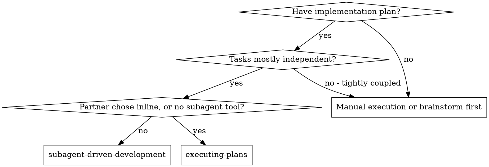
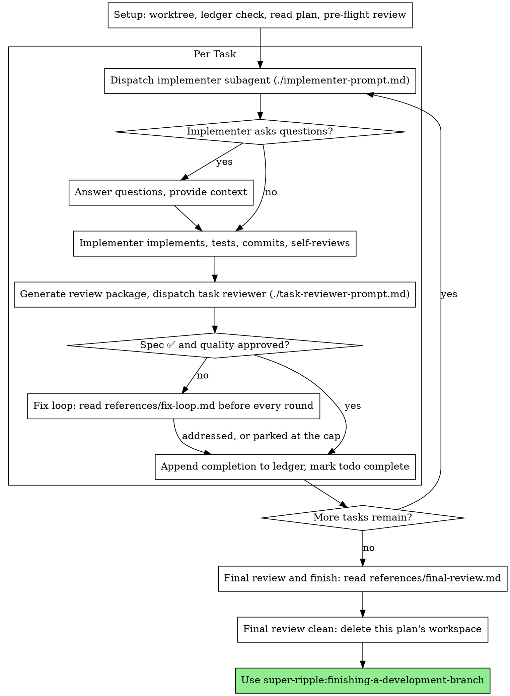

# การพัฒนาแบบขับเคลื่อนด้วย Subagent

ลงมือตามแผนโดยส่ง subagent ผู้ลงมือหน้าใหม่ต่อหนึ่งงาน รีวิวงาน (ตรงตาม spec + คุณภาพโค้ด) หลังแต่ละงาน และรีวิวกว้างทั้ง branch ตอนท้าย

**ทำไมใช้ subagent:** คุณมอบหมายงานให้ agent เฉพาะทางที่มี context แยกกัน โดยเขียนคำสั่งและบริบทให้ตรงจุด เพื่อให้พวกมันโฟกัสและทำงานสำเร็จ พวกมันต้องไม่รับ context หรือประวัติของ session คุณ - คุณสร้างเฉพาะสิ่งที่มันต้องใช้ วิธีนี้ยังช่วยรักษา context ของคุณไว้ใช้ประสานงาน

**หลักการ:** subagent หน้าใหม่ต่องาน + รีวิวงาน (spec + คุณภาพ) + รีวิวสุดท้ายแบบกว้าง = คุณภาพสูง วนซ้ำเร็ว

**การเล่า:** ระหว่างการเรียกเครื่องมือ เล่าไม่เกินหนึ่งบรรทัดสั้นๆ — ledger และผลของเครื่องมือเป็นบันทึก

**ทำต่อเนื่อง:** ห้ามหยุดถาม human partner ระหว่างงาน ทำทุกงานจากแผนโดยไม่หยุด เหตุผลเดียวที่หยุดคือสี่ข้อด้านล่าง หรือทุกงานเสร็จ การถาม "ไปต่อไหม?" และสรุปความคืบหน้าเสียเวลาของพวกเขา — พวกเขาขอให้คุณทำตามแผน ก็ทำตามแผน

**ตัดสิน ไม่ใช่หยุดค้าง** แผนที่กำลังรันไม่รอมนุษย์ ความขัดแย้ง ความกำกวม ข้อบกพร่องของแผน เพดานที่คุณอยากขอเกิน — ตัดสินมัน spec คืออำนาจที่ผูกมัด แผนคือข้อโต้แย้งของมัน และดุลยพินิจของคุณตัดสินสิ่งที่ทั้งสองไม่ตอบ บันทึกทุกการตัดสินใจใน ledger เป็น `Ruling: <สิ่งที่ตัดสิน> — <ทำไม> — <ถ้าผิดเสียอะไร>` แล้วทำต่อ ruling ที่ผิดทำให้ต้องทำใหม่ซึ่ง human partner เห็นและย้อนได้ session ที่จอดรอคำถามเสียเวลาทั้งวันของพวกเขาและไม่ได้อะไร

มีสี่อย่างที่หยุดคุณ และมีแค่นี้: การทำที่ย้อนกลับไม่ได้หรือทำลายล้าง การกระทำที่อ่อนไหวด้านความปลอดภัย ผลข้างเคียงนอก worktree นี้ที่ธรรมเนียมบอกให้ถามก่อน (merge, push ไป branch ที่ใช้ร่วมกัน, publish) และแผนที่พังจนทุกทางข้างหน้าเป็นการเดา สำหรับเรื่องเหล่านั้น หยุดและถาม

## เมื่อไหร่ควรใช้

**เทียบกับ Executing Plans (ทำในนี้):**
- subagent หน้าใหม่ต่องาน (ไม่ปนเปื้อน context) แทนที่จะให้ context เดียวทำทุกงาน
- รีวิวหลังแต่ละงาน (ตรงตาม spec + คุณภาพโค้ด) แทนที่จะรีวิวแค่ตอนท้าย
- เสียค่า context หน้าใหม่ต่องานและต่อรีวิว; ทำในนี้เสียหนึ่ง context บวกผู้รีวิวสุดท้ายหนึ่งคน
- ทั้งสองรันใน session นี้ ใช้ workspace และ ledger ของแผนร่วมกัน และไม่หยุดระหว่างงาน

## กระบวนการ

## การตั้งค่า

ให้แน่ใจว่างานเกิดใน workspace ที่แยกออกมา: ใช้ super-ripple:using-git-worktrees เพื่อสร้างหรือตรวจของที่มีอยู่ ห้ามเริ่มลงมือบน branch main/master โดยไม่ได้รับความยินยอมที่ชัดเจนจาก human partner

ความจำของบทสนทนาไม่รอดจากการบีบอัด ใน session จริง controller ที่เสียตำแหน่งเคยส่งงานซ้ำทั้งลำดับงานที่เสร็จแล้ว — ความล้มเหลวที่แพงที่สุดที่เคยพบ ติดตามความคืบหน้าในไฟล์ ledger ไม่ใช่แค่ใน todo

- แต่ละแผนมี workspace ของตัวเอง: ตอนเริ่ม skill รัน `bash scripts/sdd-workspace PLAN_FILE` ของ skill นี้ด้วยพาธสัมบูรณ์ จาก working tree ที่คุณลงมืออยู่ — มันพิมพ์ไดเรกทอรีที่ git ไม่ติดตามของแผน (ใต้ `<repo-root>/.super-ripple/sdd/`) ซึ่งเป็นที่อยู่ของทุกชิ้นงานของแผน "นี้": ledger, brief, รายงาน, แพ็กเกจรีวิว ไดเรกทอรีของแผนอื่นไม่ใช่ที่ของคุณที่จะอ่านหรือเขียน
- ตรวจ ledger ของแผนนี้ที่ `<workspace>/progress.md` ถ้ามี ให้อ่าน [references/resuming.md](references/resuming.md) ก่อนอย่างอื่น: มันบอกว่า ledger เป็นของใครและทำต่อที่ไหน
- สร้าง ledger โดยให้ตัวตนเป็นบรรทัดแรก: `# SDD ledger — plan: <พาธไฟล์แผน>`
- ledger คือแผนที่กู้คืนของคุณ: commit ที่มันระบุมีอยู่ใน git แม้ context ของคุณจะจำไม่ได้ว่าสร้าง หลังการบีบอัด เชื่อ ledger และ `git log` มากกว่าความทรงจำของคุณ
- `git clean -fdx` จะทำลาย workspace (มันเป็นที่ทิ้งงานที่ git ไม่ติดตาม) ถ้าเกิดขึ้น ให้กู้จาก `git log`

อ่านแผนหนึ่งครั้ง จดบริบทและข้อจำกัดทั่วไป และสร้าง todo หนึ่งอันต่องาน ถ้าแผนระบุ Spec ให้อ่านด้วย: spec คืออำนาจที่แผนอ้างเหตุผล และความขัดแย้งในแผนถูกตัดสินตามมัน แผนที่ไม่มี spec ที่เข้าถึงได้ ให้จดใน ledger ว่าเป็นอย่างนั้น — ruling ที่ทำโดยไม่มี spec เป็นแบบชั่วคราว

ก่อนส่งงานที่ 1 อ่าน [references/preflight.md](references/preflight.md) และรันการสแกนความขัดแย้งที่มันอธิบาย ตารางและ ruling ของมันไปอยู่ใน ledger

## การเลือกโมเดล

ใช้โมเดลที่ทรงพลังน้อยที่สุดที่รับมือแต่ละบทบาทได้ เพื่อประหยัดและเร็วขึ้น

**งานลงมือแบบกลไก** (ฟังก์ชันเดี่ยว spec ชัด 1-2 ไฟล์): ใช้โมเดลเร็วและถูก งานลงมือส่วนใหญ่เป็นแบบกลไกเมื่อแผนระบุดี

**งานเชื่อมประสานและใช้ดุลยพินิจ** (ประสานหลายไฟล์ จับรูปแบบ ดีบัก): ใช้โมเดลมาตรฐาน

**งานสถาปัตยกรรมและออกแบบ**: ใช้โมเดลที่เก่งที่สุดที่มี การรีวิวทั้ง branch ตอนท้ายเป็นงานแบบนี้ — ส่งบนโมเดลที่เก่งที่สุดที่มี ไม่ใช่ค่าตั้งต้นของ session

**งานรีวิว**: เลือกโมเดลด้วยดุลยพินิจเดียวกัน ปรับตามขนาด ความซับซ้อน และความเสี่ยงของ diff diff แบบกลไกเล็กไม่ต้องการโมเดลที่เก่งที่สุด การเปลี่ยนแปลง concurrency ที่ละเอียดอ่อนต้องการ การรีวิวซ้ำที่จำกัดขอบเขตของ diff แก้เล็กใช้ระดับถูกถึงกลาง

**การยกระดับในวงจรแก้ (รอบ 4-5)**: ใช้โมเดลที่สูงกว่าผู้ลงมือที่ติดอยู่อย่างน้อยหนึ่งระดับ

**ระบุโมเดลอย่างชัดเจนทุกครั้งที่ส่ง subagent** โมเดลที่ไม่ระบุจะสืบทอดโมเดลของ session คุณ — มักเป็นตัวที่เก่งและแพงที่สุด — ซึ่งทำลายหัวข้อนี้โดยเงียบๆ

**จำนวน turn ชนะราคา token** เวลาจริงและต้นทุน context ขยายตามจำนวน turn ที่ subagent ใช้ และโมเดลที่ถูกที่สุดมักใช้ 2-3 เท่าของ turn ในงานหลายขั้นตอน — แพงกว่าโดยรวม ใช้โมเดลระดับกลางเป็นพื้นสำหรับผู้รีวิวและผู้ลงมือที่ทำจากคำอธิบายแบบร้อยแก้ว เมื่อข้อความแผนของงานมีโค้ดที่ต้องเขียนครบ การลงมือคือการถอดความบวกการทดสอบ: ใช้ระดับถูกที่สุดสำหรับผู้ลงมือนั้น การแก้แบบกลไกไฟล์เดียวก็ใช้ระดับถูกที่สุด

**สัญญาณความซับซ้อนของงาน (งานลงมือ):**
- แตะ 1-2 ไฟล์ พร้อม spec ครบ → โมเดลถูก
- แตะหลายไฟล์ที่มีเรื่องเชื่อมประสาน → โมเดลมาตรฐาน
- ต้องใช้ดุลยพินิจด้านการออกแบบหรือความเข้าใจโค้ดเบสกว้าง → โมเดลที่เก่งที่สุด

## วงจรของงาน

**งานเล็กรูปแบบเดียวกัน:** เมื่อแผนระบุการแก้เล็กๆ ชนิดเดียวกันหลายจุดข้ามไฟล์ ให้อ่าน [references/batching.md](references/batching.md) ก่อนส่ง

ทุกอย่างที่คุณวางในพรอมต์ที่ส่ง — และทุกอย่างที่ subagent พิมพ์กลับ — อยู่ใน context ของคุณตลอดที่เหลือของ session และถูกอ่านซ้ำทุก turn ต่อมา ส่งชิ้นงานต่อกันเป็นไฟล์

**การรอ subagent ที่ส่งไป:** ห้าม poll ช่องทางรอด้วย timeout สั้นๆ และห้ามนั่งรอเงียบๆ แบบเปิดปลายเช่นกัน ขณะที่คุณมีงานในเครื่อง — อัปเดต ledger แพ็กเกจรีวิวถัดไป อ่านรายงาน — ทำงานต่อ ผลของลูกมาเอง เมื่อว่างจริงๆ รอเป็นช่วงที่มีขอบเขต (ห้าถึงสิบนาที ที่แพลตฟอร์มอนุญาต) และระหว่างช่วงให้โพสต์สถานะหนึ่งบรรทัดและกระทบยอดลูกที่ยังมีชีวิต: ลิสต์รายการ และตามตัวที่เสร็จโดยไม่รายงาน ช่วงที่มีขอบเขตรักษาเกือบทั้งหมดของประสิทธิภาพการรอยาว พร้อมรับประกันว่าลูกที่ติดหรือหายถูกสังเกตภายในไม่กี่นาที ไม่ใช่ตอนจบ session

### 1. ส่งผู้ลงมือ

บันทึก BASE (`git rev-parse HEAD`) ก่อนส่ง — แพ็กเกจรีวิวและ diff ของรอบแก้ต้องใช้มัน

- **Brief ของงาน:** ก่อนส่งผู้ลงมือ รัน `bash scripts/task-brief PLAN_FILE N` ของ skill นี้ด้วยพาธสัมบูรณ์ จาก working tree ที่คุณลงมืออยู่ — มันแยกข้อความเต็มของงานไปไฟล์ที่ชื่อไม่ซ้ำและพิมพ์พาธ เขียนการส่งให้ brief เป็นแหล่งเดียวของข้อกำหนด การส่งของคุณควรมี: (1) หนึ่งบรรทัดว่างานนี้อยู่ตรงไหนของโปรเจกต์; (2) พาธ brief แนะนำว่า "อ่านนี่ก่อน — คือข้อกำหนดของคุณ พร้อมค่าที่แน่นอนให้ใช้ตรงตัว"; (3) interface และการตัดสินใจจากงานก่อนหน้าที่ brief ไม่มีทางรู้; (4) การตัดสินความกำกวมที่คุณสังเกตใน brief; (5) พาธไฟล์รายงานและสัญญารายงาน ค่าที่แน่นอน (ตัวเลข magic string signature เทสต์เคส) ปรากฏใน brief เท่านั้น ห้ามให้ subagent อ่านทั้งไฟล์แผน
- **ไฟล์รายงาน:** ตั้งชื่อไฟล์รายงานของผู้ลงมือตาม brief (brief `…/task-N-brief.md` → รายงาน `…/task-N-report.md`) และใส่ในพรอมต์ที่ส่ง ผู้ลงมือเขียนรายงานเต็มที่นั่น และส่งกลับเพียงสถานะ commit สรุปเทสต์หนึ่งบรรทัด และข้อกังวล
- พรอมต์ที่ส่งอธิบายหนึ่งงาน ไม่ใช่ประวัติของ session ห้ามวางสรุปงานก่อนหน้าที่สะสม ("สถานะหลังงาน 1-3") ลงในการส่งหลังๆ — การส่งใน session จริงหนึ่งครั้งใหญ่ถึง 42k ตัวอักษร ซึ่ง 99% เป็นประวัติที่วางมา subagent หน้าใหม่ต้องการงานของมัน interface ที่มันแตะ และข้อจำกัดทั่วไป ไม่มีอย่างอื่น
- การส่งมีสัญญาห้ามส่ง subagent (อยู่ในเทมเพลตผู้ลงมือ): ผู้ลงมือไม่เคยส่ง subagent — ไม่ใช่ผู้ช่วย และไม่เคยเป็นผู้รีวิว การรีวิวมาจากคุณ หลังรายงาน ใน session จริง ผู้รีวิวทุกคนที่ worker สร้างซ้ำซ้อนกับการรีวิวงานที่ controller ส่งอยู่ดี — ที่นั่งรีวิวเต็มๆ เพิ่มต่อหนึ่งงาน
- ถ้างานก่อนหน้าจอดข้อค้นพบไว้ในพื้นที่ที่งานนี้แตะ ให้แนบตัวชี้ไปยังรายการ ledger นั้นในการส่ง
- บันทึกตัวตน agent ของผู้ลงมือจากผลการส่ง — รอบแก้ 1-3 ทำต่อกับ agent นี้
- ห้ามส่งผู้ลงมือหลายตัวพร้อมกัน (ชนกัน)

เทมเพลต: [implementer-prompt.md](implementer-prompt.md)

### 2. จัดการรายงาน

subagent ผู้ลงมือรายงานหนึ่งในสี่สถานะ จัดการแต่ละอย่างให้เหมาะสม:

**DONE:** สร้างแพ็กเกจรีวิว (`bash scripts/review-package PLAN_FILE BASE HEAD` ด้วยพาธสัมบูรณ์ จาก working tree ที่คุณลงมืออยู่ — มันพิมพ์พาธไฟล์เฉพาะที่เขียน; BASE คือ commit ที่คุณบันทึกก่อนส่งผู้ลงมือ — ห้ามใช้ `HEAD~1` ซึ่งทิ้งทุก commit ยกเว้นอันสุดท้ายของงานหลาย commit โดยเงียบๆ) จากนั้นส่งผู้รีวิวงานด้วยพาธที่พิมพ์

**สถานะอื่น** (DONE_WITH_CONCERNS, NEEDS_CONTEXT, BLOCKED): อ่าน [references/handling-reports.md](references/handling-reports.md) และทำตาม ทุกครั้งที่ได้รับ

ถ้าผู้ลงมือถามคำถาม — ก่อนเริ่มหรือกลางงาน — ตอบอย่างชัดเจนและครบถ้วน ให้บริบทเพิ่มถ้าจำเป็น และอย่าเร่งมันให้ลงมือ

### 3. รีวิวงาน

การรีวิวต่องานเป็นด่านขอบเขตงาน การรีวิวกว้างเกิดครั้งเดียวตอนรีวิวทั้ง branch สุดท้าย ห้ามข้ามการรีวิวงาน และห้ามรับรายงานที่ขาดคำตัดสินใดคำตัดสินหนึ่ง — ทั้งตรงตาม spec และคุณภาพงานต้องมี การรีวิวตัวเองของผู้ลงมือไม่เคยแทนที่การรีวิวงาน ต้องมีทั้งสอง

- ส่ง diff ให้ผู้รีวิวเป็นไฟล์: รัน `bash scripts/review-package PLAN_FILE BASE HEAD` ของ skill นี้ด้วยพาธสัมบูรณ์ จาก working tree ที่คุณลงมืออยู่ และส่งพาธไฟล์ที่มันพิมพ์ให้ผู้รีวิว (หรือถ้าไม่มี bash: `git log --oneline`, `git diff --stat` และ `git diff -U10` ของช่วงนั้น เปลี่ยนเส้นทางไปไฟล์เดียวที่ชื่อไม่ซ้ำ) ผลลัพธ์ไม่เข้า context ของคุณ และผู้รีวิวเห็นรายการ commit สรุป stat และ diff เต็มพร้อมบริบทในการ Read ครั้งเดียว ใช้ BASE ที่คุณบันทึกก่อนส่งผู้ลงมือ — ห้ามใช้ `HEAD~1` ที่ตัดงานหลาย commit โดยเงียบๆ ห้ามส่งผู้รีวิวงานโดยไม่มีไฟล์ diff
- **อินพุตของผู้รีวิว:** ผู้รีวิวงานได้สามพาธ — ไฟล์ brief เดียวกัน ไฟล์รายงาน และแพ็กเกจรีวิว — บวกข้อจำกัดทั่วไปที่ผูกกับงาน
- บล็อกข้อจำกัดทั่วไปที่คุณส่งให้ผู้รีวิวคือเลนส์ความสนใจของมัน คัดลอกข้อกำหนดที่ผูกมัดตรงตัวจากส่วนข้อจำกัดทั่วไปของแผนหรือ spec: ค่าที่แน่นอน รูปแบบที่แน่นอน และความสัมพันธ์ที่ระบุระหว่าง component ("เลย์เอาต์เดียวกับ X", "ตรงกับ Y") เทมเพลตของผู้รีวิวมีกฎกระบวนการอยู่แล้ว (YAGNI, ความสะอาดของเทสต์, วิธีรีวิว) — บล็อกข้อจำกัดมีไว้สำหรับสิ่งที่ spec ของโปรเจกต์ "นี้" ต้องการ
- อย่าเพิ่มคำสั่งปลายเปิดอย่าง "ตรวจทุกการใช้งาน" หรือ "รันเทสต์ race ถ้าเป็นประโยชน์" โดยไม่มีเหตุผลเฉพาะงานที่เป็นรูปธรรม
- อย่าขอให้ผู้รีวิวรันเทสต์ซ้ำที่ผู้ลงมือรันแล้วบนโค้ดเดียวกัน — รายงานของผู้ลงมือมีหลักฐานเทสต์
- อย่าตัดสินข้อค้นพบล่วงหน้าแทนผู้รีวิว — ห้ามสั่งผู้รีวิวให้เพิกเฉยหรือไม่ต้องแจ้งปัญหาเฉพาะ ถ้าเชื่อว่าข้อค้นพบหนึ่งเป็น false positive ปล่อยให้ผู้รีวิวยกขึ้นมาและตัดสินในวงจรรีวิว ถ้าพรอมต์ที่คุณกำลังเขียนมี "ห้ามแจ้ง", "อย่าถือว่า X เป็นข้อบกพร่อง", "อย่างมากแค่ Minor" หรือ "แผนเลือกแล้ว" — หยุด: คุณกำลังตัดสินล่วงหน้า ซึ่งมักเพื่อเลี่ยงวงจรรีวิว
ถ้าผู้รีวิวรายงานรายการ "⚠️ Cannot verify from diff" ให้อ่าน [references/cannot-verify.md](references/cannot-verify.md) ก่อนทำเครื่องหมายงานว่าเสร็จ

เทมเพลต: [task-reviewer-prompt.md](task-reviewer-prompt.md)

### 4. วงจรแก้

วงจรทำงานเมื่อรีวิวรายงาน spec ❌, ข้อค้นพบ Critical หรือ Important ใดๆ หรือรายการ ⚠️ ที่คุณยืนยันว่าเป็นช่องว่างจริง

เมื่อทำงาน ให้อ่าน [references/fix-loop.md](references/fix-loop.md) และทำตาม อ่านซ้ำก่อนทุกรอบ แม้จะอ่านไปแล้วใน session นี้: มันมีเพดานรอบ ตัวตัดวงจร และบรรทัด ledger ที่แต่ละรอบเขียน และความทรงจำของคุณไม่รอดจากการบีบอัด

### 5. จบงาน

เมื่อรีวิวกลับมาสะอาด — หรือทุกข้อค้นพบที่เปิดอยู่ถูกจอดพร้อม ruling ที่เพดาน — ต่อบรรทัดความสมบูรณ์ลง ledger ในข้อความเดียวกับงานบัญชีอื่น:

- `Task <N>: complete (commits <base7>..<head7>, review clean)`
- `Task <N>: complete (commits <base7>..<head7>, <K> parked)` หลังตัวตัดวงจรทำงาน

จากนั้นทำเครื่องหมาย todo เสร็จและไปต่อ ห้ามไปงานถัดไปขณะที่รีวิวมีปัญหา Critical/Important เปิดอยู่ที่ไม่ได้ถูกแก้หรือจอดพร้อม ruling ที่เพดาน

## รีวิวสุดท้าย

เมื่อทุกงานเสร็จ อ่าน [references/final-review.md](references/final-review.md) และทำตาม มันครอบคลุมการรีวิวทั้ง branch คลื่นการแก้ครั้งเดียว และวิธีที่คุณจบงาน

## ข้ออ้างที่พบบ่อย

| ข้ออ้าง | ความจริง |
|--------|---------|
| "ใกล้เคียงพอเรื่องตรงตาม spec" | ผู้รีวิวพบช่องว่างของ spec = ยังไม่เสร็จ แก้หรือถึงเพดานแล้วตัดสิน — นั่นคือทางออกเดียว |
| "ผมแก้เองดีกว่า การส่งเป็นภาระ" | controller แก้เองปนเปื้อน context ของคุณและข้ามการรีวิว ทำต่อกับผู้ลงมือ |
| "อีกรอบเดียวน่าจะลู่เข้า" | เกินเพดาน รอบไม่ลู่เข้า — ความล้มเหลวเป็นเชิงโครงสร้าง ตัดสินและส่งต่อ |
| "ผู้รีวิวก็จะหาอะไรใหม่ได้อีกอยู่ดี" | การรีวิวซ้ำที่จำกัดขอบเขตตรวจการแก้ มันเตร็ดเตร่ไม่ได้ ข้อค้นพบใหม่บนโค้ดที่ไม่ได้แตะไปที่ ledger ไม่ใช่วงจร |
| "ข้อค้นพบนี้ผิดชัดๆ ทิ้งเลย" | คุณตัดสินเฉพาะที่เพดาน และทุก ruling เป็นรายการ ledger การทิ้งแบบเงียบห้ามทำ |
| "การแก้เล็ก ข้ามรีวิวซ้ำ" | การแก้ที่ไม่ผ่านรีวิวคือวิธีที่ regression ลงมา ทุกรอบจบด้วยรีวิวซ้ำที่จำกัดขอบเขต |
| "รีวิวทำให้วงจรช้า" | วงจรที่ไม่มีรีวิวคือการวุ่นวายที่ไม่ได้ตรวจสอบ รีวิวคือเบรกและพวงมาลัยของวงจร |
| "งานบัญชี ledger เป็นภาระ" | ledger คือสิ่งที่รอดจากการบีบอัด controller ที่ไม่มีมันเคยส่งงานซ้ำทั้งลำดับที่เสร็จแล้ว |
| "ผู้ลงมือสร้างผู้รีวิวของตัวเอง — ได้ความมั่นใจเพิ่มฟรี" | มันคือที่นั่งซ้ำที่รีวิว diff เดียวกัน การรีวิวงานคือด่าน ผู้รีวิวที่ worker สร้างเป็นข้อบกพร่องที่ต้องแจ้ง ไม่ใช่ความเข้มงวด |
