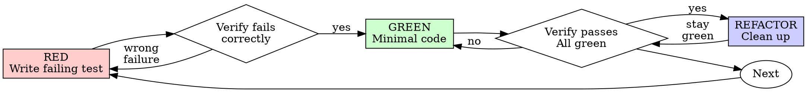

# การพัฒนาโดยใช้เทสต์นำ (TDD)

## ภาพรวม

เขียนเทสต์ก่อน ดูมันล้มเหลว เขียนโค้ดน้อยที่สุดให้ผ่าน

**หลักการ:** ถ้าไม่ได้ดูเทสต์ล้มเหลว คุณไม่รู้ว่ามันทดสอบสิ่งที่ถูกหรือเปล่า

**ละเมิดตัวอักษรของกฎ คือละเมิดเจตนารมณ์ของกฎ**

## เมื่อไหร่ควรใช้

**เสมอ:**
- ฟีเจอร์ใหม่
- แก้บั๊ก
- Refactor
- เปลี่ยนพฤติกรรม

**ข้อยกเว้น (ถาม human partner ของคุณ):**
- Prototype ที่ใช้แล้วทิ้ง
- โค้ดที่ถูกสร้างขึ้น
- ไฟล์ configuration

คิดว่า "ข้าม TDD ครั้งเดียวเอง"? หยุด นั่นคือการหาเหตุผลเข้าข้างตัวเอง

## กฎเหล็ก

```
ห้ามมีโค้ด production ถ้ายังไม่มีเทสต์ที่ล้มเหลวมาก่อน
```

เขียนโค้ดก่อนเทสต์? ลบมัน เริ่มใหม่

**ไม่มีข้อยกเว้น:**
- อย่าเก็บไว้เป็น "ตัวอ้างอิง"
- อย่า "ดัดแปลง" มันตอนเขียนเทสต์
- อย่ามองมัน
- ลบคือลบ

สร้างใหม่จากเทสต์ จบ

## Red-Green-Refactor



### RED - เขียนเทสต์ที่ล้มเหลว

เขียนเทสต์น้อยที่สุดหนึ่งตัวที่แสดงว่าควรเกิดอะไร

<Good>
```typescript
test('retries failed operations 3 times', async () => {
  let attempts = 0;
  const operation = () => {
    attempts++;
    if (attempts < 3) throw new Error('fail');
    return 'success';
  };

  const result = await retryOperation(operation);

  expect(result).toBe('success');
  expect(attempts).toBe(3);
});
```
ชื่อชัดเจน ทดสอบพฤติกรรมจริง ทำเรื่องเดียว
</Good>

<Bad>
```typescript
test('retry works', async () => {
  const mock = jest.fn()
    .mockRejectedValueOnce(new Error())
    .mockRejectedValueOnce(new Error())
    .mockResolvedValueOnce('success');
  await retryOperation(mock);
  expect(mock).toHaveBeenCalledTimes(3);
});
```
ชื่อคลุมเครือ ทดสอบ mock ไม่ใช่โค้ด
</Bad>

**ข้อกำหนด:**
- พฤติกรรมเดียว
- ชื่อชัดเจน
- โค้ดจริง (ไม่ใช้ mock เว้นแต่เลี่ยงไม่ได้)

### ตรวจ RED - ดูมันล้มเหลว

**บังคับ ห้ามข้าม**

```bash
npm test path/to/test.test.ts
```

ยืนยัน:
- เทสต์ล้มเหลว (ไม่ใช่เกิด error)
- ข้อความที่ล้มเหลวตรงตามคาด
- ล้มเหลวเพราะฟีเจอร์ยังไม่มี (ไม่ใช่พิมพ์ผิด)

**เทสต์ผ่าน?** คุณกำลังทดสอบพฤติกรรมที่มีอยู่แล้ว แก้เทสต์

**เทสต์เกิด error?** แก้ error รันซ้ำจนมันล้มเหลวอย่างถูกต้อง

### GREEN - โค้ดน้อยที่สุด

เขียนโค้ดที่ง่ายที่สุดให้เทสต์ผ่าน

<Good>
```typescript
async function retryOperation<T>(fn: () => Promise<T>): Promise<T> {
  for (let i = 0; i < 3; i++) {
    try {
      return await fn();
    } catch (e) {
      if (i === 2) throw e;
    }
  }
  throw new Error('unreachable');
}
```
พอให้ผ่านเท่านั้น
</Good>

<Bad>
```typescript
async function retryOperation<T>(
  fn: () => Promise<T>,
  options?: {
    maxRetries?: number;
    backoff?: 'linear' | 'exponential';
    onRetry?: (attempt: number) => void;
  }
): Promise<T> {
  // YAGNI
}
```
ออกแบบเกินจำเป็น
</Bad>

อย่าเพิ่มฟีเจอร์ อย่า refactor โค้ดอื่น อย่า "ปรับปรุง" เกินกว่าเทสต์

### ตรวจ GREEN - ดูมันผ่าน

**บังคับ**

```bash
npm test path/to/test.test.ts
```

ยืนยัน:
- เทสต์ผ่าน
- เทสต์อื่นยังผ่าน
- ผลลัพธ์สะอาด (ไม่มี error, warning)

**เทสต์ล้มเหลว?** แก้โค้ด ไม่ใช่เทสต์

**เทสต์อื่นล้มเหลว?** แก้เดี๋ยวนี้

**"เทสต์อื่น" หมายถึงชุดเทสต์ของโปรเจกต์ ไม่ใช่แค่ไฟล์ของคุณ** การรันเทสต์ที่คุณเขียนแล้วเขียวไม่ใช่ชุดเทสต์เขียว ก่อนบอกว่าการเปลี่ยนแปลงเสร็จ ให้รันคำสั่งเทสต์ของโปรเจกต์ (`pytest` เปล่าๆ, `npm test`, `cargo test` — อะไรที่ repo ใช้) แม้งานของคุณจะระบุไฟล์เทสต์เดียว ขอบเขตที่ระบุในงานจำกัดสิ่งที่ต้องส่งมอบ ไม่ใช่การตรวจสอบของคุณ ความล้มเหลวใดๆ ที่การรันนั้นแสดง — รวมถึงอันที่คุณไม่ได้ก่อ — ต้องอยู่ในรายงานของคุณโดยระบุชื่อ เทสต์แดงที่คุณเห็นเลื่อนผ่านแล้วไม่พูดถึงคือรายงานที่บิดเบือนด้วยการละเว้น

### REFACTOR - ทำความสะอาด

หลังเขียวเท่านั้น:
- ลบความซ้ำซ้อน
- ปรับปรุงชื่อ
- แยก helper

รักษาเทสต์ให้เขียว อย่าเพิ่มพฤติกรรม

### ทำซ้ำ

เทสต์ที่ล้มเหลวตัวถัดไปสำหรับฟีเจอร์ถัดไป

## เทสต์ที่ดี

| คุณภาพ | ดี | แย่ |
|---------|------|-----|
| **น้อยที่สุด** | เรื่องเดียว มี "และ" ในชื่อ? แยกซะ | `test('validates email and domain and whitespace')` |
| **ชัดเจน** | ชื่ออธิบายพฤติกรรม | `test('test1')` |
| **แสดงเจตนา** | แสดง API ที่ต้องการ | บดบังสิ่งที่โค้ดควรทำ |

เมื่อเขียนหรือแก้เทสต์ใดๆ ให้อ่าน [writing-good-tests.md](writing-good-tests.md) สำหรับกฎที่ทำให้เทสต์ซื่อสัตย์:
- ระบุการเปลี่ยนแปลงใน production ที่จะทำให้เทสต์ล้มเหลว — ก่อนเขียนมัน
- Assert พฤติกรรมจริง ไม่ใช่พฤติกรรมของ mock
- เก็บโค้ดเฉพาะเทสต์ไว้ใน test utility ไม่ใช่ในคลาส production
- เข้าใจผลข้างเคียงของ dependency ก่อน mock มัน

## ข้ออ้างที่พบบ่อย

| ข้ออ้าง | ความจริง |
|--------|---------|
| "ง่ายเกินกว่าจะเทสต์" | โค้ดง่ายก็พังได้ เทสต์ใช้เวลา 30 วินาที |
| "เดี๋ยวเทสต์ทีหลัง" | เทสต์ที่เขียนทีหลังผ่านทันที — ซึ่งพิสูจน์อะไรไม่ได้ มันอาจทดสอบผิดสิ่ง ทดสอบการทำงานภายในแทนพฤติกรรม หรือพลาด edge case ที่คุณลืม คุณไม่เคยเห็นมันล้มเหลว จึงไม่เคยพิสูจน์ว่ามันจับบั๊กได้ การเขียนเทสต์ก่อนบังคับให้เกิดความล้มเหลวนั้น |
| "เทสต์ทีหลังได้เป้าหมายเดียวกัน (เจตนารมณ์ ไม่ใช่พิธีกรรม)" | เทสต์ทีหลังตอบ "สิ่งนี้ทำอะไร?" เทสต์ก่อนตอบ "สิ่งนี้ควรทำอะไร?" เทสต์ที่เขียนทีหลังถูกโค้ดที่คุณเขียนแล้วทำให้เอนเอียง — คุณตรวจเฉพาะกรณีที่จำได้ ไม่ใช่กรณีที่คุณจะค้นพบ ได้ coverage แต่ไม่มีหลักฐานว่าเทสต์ใช้ได้ |
| "ทดสอบด้วยมือแล้ว" | การทดสอบด้วยมือเป็นแบบเฉพาะกิจ: ไม่มีบันทึกว่าครอบคลุมอะไร รันซ้ำเมื่อโค้ดเปลี่ยนไม่ได้ ลืมกรณีง่ายเมื่อถูกกดดัน "ตอนลองก็ใช้ได้" ≠ ครอบคลุม เทสต์อัตโนมัติรันเหมือนเดิมทุกครั้ง |
| "ลบไปหลายชั่วโมงเสียของ" | ความเข้าใจผิดเรื่อง sunk cost — เวลานั้นหมดไปแล้วไม่ว่าทางไหน ทางเลือกจริง: เขียนใหม่ด้วย TDD (มั่นใจสูง) หรือเก็บไว้แล้วเสริมเทสต์ทีหลัง (มั่นใจต่ำ มีบั๊กแน่) การเก็บโค้ดที่ไว้ใจไม่ได้คือความสูญเปล่า |
| "เก็บไว้เป็นตัวอ้างอิง เขียนเทสต์ก่อน" | คุณจะดัดแปลงมัน นั่นคือเทสต์ทีหลัง ลบคือลบ |
| "ต้องสำรวจก่อน" | ได้ ทิ้งการสำรวจ แล้วเริ่มด้วย TDD |
| "เทสต์ยาก = ออกแบบยังไม่ชัด" | ฟังเทสต์ ทดสอบยาก = ใช้ยาก |
| "TDD จะทำให้ช้า" | TDD คือทางที่เป็นจริง: จับบั๊กก่อน commit ป้องกัน regression ให้ refactor ได้ไม่กลัว ทางลัดแบบ "เป็นจริง" หมายถึงดีบักบน production — ช้ากว่า ไม่ใช่เร็วกว่า |
| "ทดสอบด้วยมือเร็วกว่า" | ด้วยมือไม่พิสูจน์ edge case คุณจะทดสอบซ้ำทุกการเปลี่ยนแปลง |
| "โค้ดเดิมไม่มีเทสต์" | คุณกำลังปรับปรุงมัน เพิ่มเทสต์ให้โค้ดเดิม |

## สัญญาณเตือน - หยุดและเริ่มใหม่

- โค้ดมาก่อนเทสต์
- เทสต์หลังลงมือทำ
- เทสต์ผ่านทันที
- อธิบายไม่ได้ว่าทำไมเทสต์ล้มเหลว
- เทสต์ที่เพิ่ม "ทีหลัง"
- หาเหตุผลว่า "ครั้งเดียวเอง"
- "ทดสอบด้วยมือแล้ว"
- "เทสต์ทีหลังได้จุดประสงค์เดียวกัน"
- "มันเรื่องเจตนารมณ์ ไม่ใช่พิธีกรรม"
- "เก็บไว้เป็นตัวอ้างอิง" หรือ "ดัดแปลงโค้ดเดิม"
- "ใช้ไปหลายชั่วโมงแล้ว ลบมันเสียของ"
- "TDD เคร่งเกินไป ผมเป็นคนปฏิบัติจริง"
- "อันนี้ต่างออกไปเพราะ..."

**ทั้งหมดนี้หมายความว่า: ลบโค้ด เริ่มใหม่ด้วย TDD**

## ตัวอย่าง: แก้บั๊ก

**บั๊ก:** อีเมลว่างถูกยอมรับ

**RED**
```typescript
test('rejects empty email', async () => {
  const result = await submitForm({ email: '' });
  expect(result.error).toBe('Email required');
});
```

**ตรวจ RED**
```bash
$ npm test
FAIL: expected 'Email required', got undefined
```

**GREEN**
```typescript
function submitForm(data: FormData) {
  if (!data.email?.trim()) {
    return { error: 'Email required' };
  }
  // ...
}
```

**ตรวจ GREEN**
```bash
$ npm test
PASS
```

**REFACTOR**
แยกการตรวจสอบเป็นฟังก์ชันกลางถ้าต้องรองรับหลายฟิลด์

## เช็กลิสต์การตรวจสอบ

ก่อนทำเครื่องหมายว่างานเสร็จ:

- [ ] ทุกฟังก์ชัน/method ใหม่มีเทสต์
- [ ] ดูเทสต์ทุกตัวล้มเหลวก่อนเขียนโค้ดจริง
- [ ] แต่ละเทสต์ล้มเหลวด้วยเหตุผลที่คาดไว้ (ฟีเจอร์ไม่มี ไม่ใช่พิมพ์ผิด)
- [ ] เขียนโค้ดน้อยที่สุดให้แต่ละเทสต์ผ่าน
- [ ] เทสต์ทั้งหมดผ่าน
- [ ] ผลลัพธ์สะอาด (ไม่มี error, warning)
- [ ] เทสต์ใช้โค้ดจริง (mock เฉพาะที่เลี่ยงไม่ได้)
- [ ] ครอบคลุม edge case และ error

ติ๊กไม่ครบ? คุณข้าม TDD เริ่มใหม่

## เมื่อติดขัด

| ปัญหา | วิธีแก้ |
|---------|----------|
| ไม่รู้จะเทสต์อย่างไร | เขียน API ที่อยากได้ เขียน assertion ก่อน ถาม human partner |
| เทสต์ซับซ้อนเกินไป | การออกแบบซับซ้อนเกินไป ทำ interface ให้ง่ายขึ้น |
| ต้อง mock ทุกอย่าง | โค้ดผูกกันแน่นเกินไป ใช้ dependency injection |
| การตั้งค่าเทสต์ใหญ่โต | แยก helper ยังซับซ้อน? ทำการออกแบบให้ง่ายขึ้น |

## การเชื่อมกับการดีบัก

เจอบั๊ก? เขียนเทสต์ที่ล้มเหลวทำซ้ำมัน ทำตามวงจร TDD เทสต์พิสูจน์การแก้และป้องกัน regression

ห้ามแก้บั๊กโดยไม่มีเทสต์

## กฎสุดท้าย

```
โค้ด production → เทสต์มีอยู่และล้มเหลวมาก่อน
ไม่เช่นนั้น → ไม่ใช่ TDD
```

ไม่มีข้อยกเว้นถ้าไม่ได้รับอนุญาตจาก human partner ของคุณ
